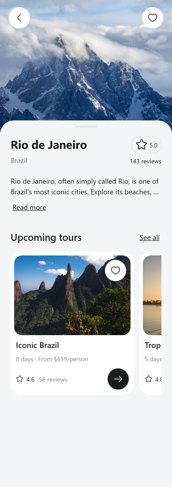
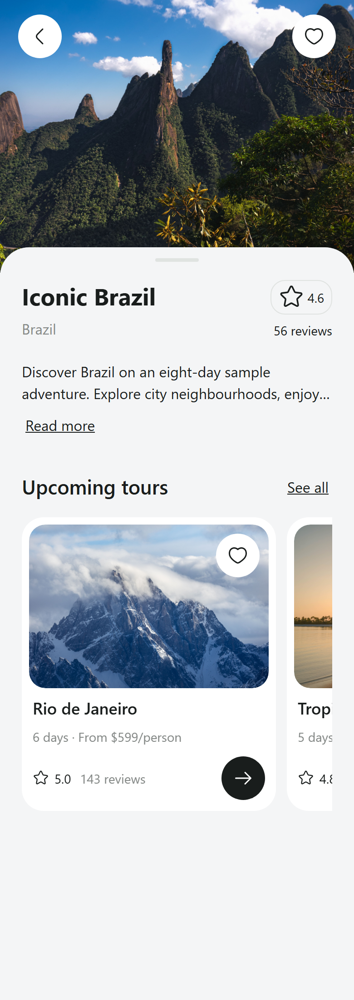
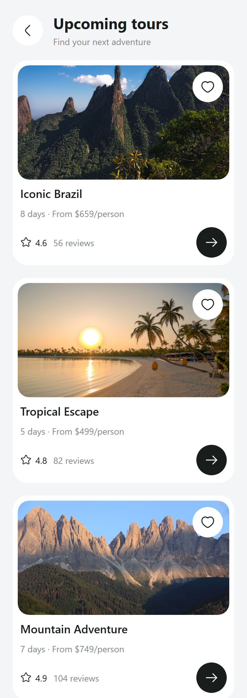

# Ronas " Travel Explorer " 

Ronas is a travel browsing app built while learning React Native. It helps users explore a destination, browse four sample tours, read tour details, and mark favourites.

The design uses large travel photos, rounded panels, reusable cards, and custom SVG icons. The app runs on iOS, Android, and the web using Expo.

## Screenshots

These are screenshots of the running web app at a phone-sized viewport, not iOS simulator screenshots.

| Destination | Tour details | All tours |
| --- | --- | --- |
|  |  |  |

## Features

- Destination screen for Rio de Janeiro, with a photo, country, rating, and review count.
- Expandable descriptions: tap **Read more** to expand and **Read less** to collapse.
- Four horizontally scrolling tour cards: Iconic Brazil, Tropical Escape, Mountain Adventure, and Forest Retreat.
- Days, starting prices, ratings, and review counts on each card.
- Heart buttons that fill when saved and show an alert when saved or removed.
- Shared favourites: a tour's card and details header show the same saved state.
- Tour photos, names, and arrow buttons open that tour's details screen.
- Upcoming cards exclude the open destination. Opening Iconic Brazil from Rio replaces the Iconic Brazil card with Rio.
- **See all** shows the same available alternatives; opening the list directly shows all five destinations.
- Every tour opens the same destination layout as Rio: photo header, rounded panel, location, rating, description, and sideways upcoming-tour cards.
- Back buttons return to the previous screen. Directly opened pages have a fallback destination.
- Friendly fallback for an unknown tour ID.

## Project status

This is a learning project with local sample data. It is not a booking service.

- The Rio card uses a sample duration of 6 days and a sample price of $599.
- Prices are example amounts in **USD per person**.
- Ratings, review counts, descriptions, and highlights are sample content.
- Photos are illustrative and may not show the destination named in the app.
- Favourites are held in memory. They stay in sync while navigating, but reset when the app reloads or restarts.
- No account system, payment, booking, backend, or database is included.
- Review counts are display information; there is no reviews page yet.

## Built with

| Tool | Purpose |
| --- | --- |
| Expo SDK 58 | Runs and develops the app |
| React Native | Builds the mobile interface |
| React | Components, state, and shared favourites |
| TypeScript | Checks the types of values used in code |
| Expo Router | Moves between screens using files in `src/app` |
| React Native Safe Area Context | Keeps content away from phone cutouts and system bars |
| React Native SVG | Draws the downloaded Central Icons shapes |

Exact dependency versions are in `package.json` and `package-lock.json`.

## What you need

- Node.js and npm. Use a Node version supported by Expo SDK 58; this project has been developed with Node 24.
- Git, if you want to clone and save changes.
- VS Code or another editor.
- For a real phone: Expo Go with support for this project's SDK, or a compatible development build.
- For Android emulation: Android Studio with a configured, running emulator.
- For the local iOS simulator: macOS and Xcode. A Windows computer can still serve the app to a physical iPhone.

## Download and run

```bash
git clone https://github.com/Kgwale-NN/ronas.git
cd ronas
npm ci
npx expo start
```

`npm ci` installs the versions recorded in the lockfile. Keep the terminal open while using the app. Press **Ctrl + C** to stop the server.

### Run on a phone

1. Install a compatible Expo Go app on your phone.
2. Connect your computer and phone to the same Wi-Fi network.
3. Run `npx expo start` in the project folder.
4. On Android, scan the terminal QR code in Expo Go. On iPhone, scan with the Camera app and open the link.
5. Save a code change in your editor to see it update on the phone.

If Expo asks for matching accounts, sign into Expo Go and the computer with the same Expo account:

```bash
npx expo login
npx expo whoami
```

If browser login fails to open on Windows, use:

```bash
npx expo login --no-browser
```

Enter your password only into the login prompt. Never add it to a source file or Git commit.

### Run on the web

```bash
npm run web
```

Open the address printed by Expo. You can also press **w** in an existing Expo terminal. Web preview can differ slightly from a real phone.

### Run on an emulator

Start your Android emulator, then press **a** in the Expo terminal, or run `npm run android`. On a Mac with an iOS simulator installed, use `npm run ios`.

## How to use the app

1. Start on the Rio destination screen.
2. Tap its heart to save or remove the destination; dismiss the confirmation alert.
3. Tap **Read more** to read the full description.
4. Swipe the tour cards sideways to browse the four tours.
5. Tap a card's heart to save that tour without opening it.
6. Tap a tour photo, name, or arrow to open its details.
7. On the details page, read the description and browse the upcoming-tour cards. Its heart uses the same saved state as the card.
8. Tap the back arrow to return.
9. Tap **See all** on the destination screen to browse the full list.

## Folders and files

```text
assets/images/                 Local travel photos
docs/screenshots/              App screenshots used in this README
src/
  app/
    _layout.tsx                Navigation stack and shared app setup
    index.tsx                  Rio destination screen
    tours.tsx                  Full tour list
    tour/[id].tsx              Details for the tour named by its ID
  components/
    TextAction.tsx             Text button with hover, focus, and tap feedback
    CircleButton.tsx           Reusable round button
    DestinationDetails.tsx     Shared full layout for Rio and every tour
    DestinationHeader.tsx      Large photo, back button, and heart
    ExpandableDescription.tsx  Text with Read more / Read less
    RatingBadge.tsx            Star and rating inside a small border
    SectionHeader.tsx          Section name and action button
    TourCard.tsx               Reusable tour photo and information
    icons/                     Central Icons adapted to SVG components
  constants/travel-theme.ts    Shared colours
  context/FavoritesContext.tsx Shared saved IDs and confirmation alerts
  data/tours.ts                Rio and the four tours, plus the upcoming-list rule
```

`[id].tsx` is a dynamic route. One screen displays different tours by reading an ID such as `iconic-brazil` from the route. We do not need four copies of the details screen.

## Add or edit a tour

1. Put its photo in `assets/images`.
2. Add an entry in `src/data/tours.ts` with a unique `id`, local image, name, location, days, price, rating, reviews, description, and highlights.
3. Use a literal image path, for example `require("../../assets/images/tour-brazil.jpg")`.

The home cards, full list, and details page all read this shared data file. The ID also connects the tour's saved state across screens.

## Checks

```bash
npx tsc --noEmit
npm run lint
```

TypeScript and ESLint are configured in this project. Run both commands before submitting. ESLint uses the Expo configuration in `eslint.config.js`.

Before pushing, manually check: all four tours open the correct details, back navigation works, both types of heart show alerts and fill, saved state matches between screens, Read more toggles, and See all shows every tour.

## Save changes to GitHub

```bash
git status
git add <the-files-you-changed>
git diff --cached
git commit -m "Describe your change"
git push
```

Review the staged files before committing. Avoid committing passwords, `.env` secrets, or `node_modules`.

## Common problems

| Problem | What to check |
| --- | --- |
| Unable to resolve an image | The filename and path must match exactly. Check for `.jpg.jpg` or a different extension. |
| Phone cannot connect | Keep Expo running; check both devices are on the same Wi-Fi. If the network blocks local connections, try `npx expo start --tunnel` and follow its prompts. |
| Expo requests sign-in | Use `npx expo whoami` and compare the account with Expo Go. Restart the server after login. |
| Expo Go reports incompatible SDK | Use an Expo Go version supporting SDK 58 or a compatible development build. |
| Old screen remains | Press **r** in Expo. If necessary restart with `npx expo start --clear`. |
| Saved hearts reset | Expected: favourites are currently kept in memory only. |
| A large blank area appears | Ensure the photo and panel are inside `<ScrollView>...</ScrollView>`, not after a self-closing `<ScrollView />`. |

## Images, icons, and credits

- Travel photos were selected from [Pexels](https://www.pexels.com/). Keep original photographer/source links when adding future photos; exact source links for the current downloads have not been recorded.
- Heart, back, star, and arrow shapes come from [Central Icons](https://centralicons.com/) and were adapted for `react-native-svg`. Check the applicable Central Icons licence before redistributing or publishing its assets; repository code licensing does not replace third-party asset terms.
- Built as a React Native learning project by [Kgwale-NN](https://github.com/Kgwale-NN).
- See the repository's `LICENSE` file for project code terms.

## Android APK submission

The `preview` profile in `eas.json` requests an installable Android APK. The app package is `com.kgwalenn.ronas`. The Android preview APK has been built successfully.

```bash
npx eas-cli@latest login
npx eas-cli@latest build:configure --platform android
npx eas-cli@latest build --platform android --profile preview
```

Follow the Expo prompts to connect this local app to your Expo project and set up Android signing. Never commit signing keys or passwords. Download the APK after the build succeeds, install it on an Android phone, and check the app before submitting.

Download the APK from the [Ronas APK Google Drive folder](https://drive.google.com/drive/folders/1MtKc6e56-8KuXzZ973fRPfkVOsU5BK96?usp=drive_link). Open the folder, select the APK file, and download it to an Android phone. An Android APK does not install on iPhone.

## Screen sizes and interaction

- Destination pages stay centred and at most 600 units wide on large web windows.
- Narrow screens and large phone text settings can place the rating below the name.
- Horizontal cards shrink on small screens; the full list fills the available width.
- Text actions and round buttons change colour on mouse hover and keyboard focus.
- Touch presses give visual feedback without needing a mouse.

## Possible next steps

- Keep favourites after closing the app.
- Add search and filtering to the full tour list.
- Add real review content and real tour data.
- Add booking only after defining a backend and payment flow.

## Useful documentation

- [Expo SDK 58](https://docs.expo.dev/versions/v58.0.0/)
- [Expo Router navigation](https://docs.expo.dev/router/basics/navigation/)
- [React Native](https://reactnative.dev/docs/getting-started)
